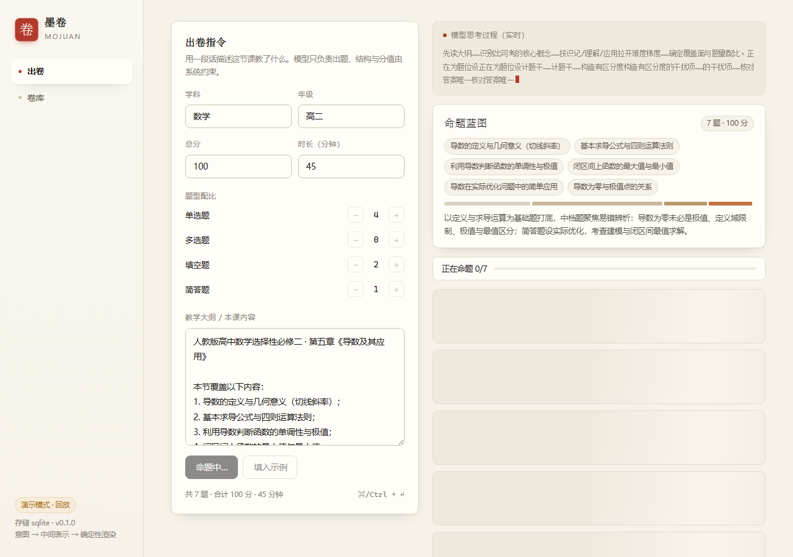

# 墨卷 MoJuan · 意图编译型自适应测评引擎

> 老师用一段话描述"这节课教了什么"，墨卷产出**可编辑、可校验、可导出**的试卷；
> 学生作答后系统**确定性评分**并给出学情大盘。

**参赛命题方向**：低代码与智能表单生成引擎（赛题方向 #4）
**核心主张**：不让 AI 写页面，让 AI 写**受校验的中间表示（QuizIR）**，再由确定性渲染器执行。



---

## 1. 10 分钟极速复现

### 1.1 环境要求

| 项 | 要求 | 说明 |
|---|---|---|
| Node.js | **>= 20.11**（推荐 22 LTS 或 24） | `node -v` 自检 |
| npm | >= 9 | 随 Node 安装 |
| 操作系统 | Windows / macOS / Linux | 无原生编译依赖 |
| 网络 | 仅首次装依赖需要 | 演示模式**完全离线** |

> 本项目**没有任何 node-gyp 原生模块**：数据库用 Node 内置 `node:sqlite`，不可用时自动降级为 JSON 文件存储。

### 1.2 三条命令

```bash
npm install          # 约 30–60 秒
npm run build        # 构建前端（约 1 秒）
npm start            # 启动，访问 http://127.0.0.1:4000
```

### 1.3 自检（评委请先跑这一条）

```bash
npm run verify
```

期望输出：

```
  ✓ 环境与仓储初始化
  ✓ 回放生成一份试卷且 IR 通过 zod
  ✓ 业务规则校验（分值/答案/蓝图一致）
  ✓ 公式可被 KaTeX 渲染
  ✓ 人工改题可持久化
  ✓ 提交作答 → 确定性评分
  ✓ 学情统计与作答一致
  ✓ IR 导出可下载且结构完整
  ✓ 无 Key 回放具备确定性

9/9 passed
```

自检**不读取 API Key、不访问网络**，跑在临时目录里，不会污染你的数据。

### 1.4 想看完整闭环？灌一批演示数据

```bash
npm start                 # 另开一个终端，保持服务运行
npm run seed              # 生成一份试卷 + 12 份作答
```

然后打开终端里打印的地址（形如 `http://127.0.0.1:4000/#/stats/paper_xxx`）。

### 1.5 一键演示（录屏 / 答辩用）

```
http://127.0.0.1:4000/?demo=1#/
```

打开即自动填入示例大纲并跑完一次生成，可以直接看到：模型思考流 → 命题蓝图 → 逐题落地 → 校验结果。

### 1.6 复现记录

最近一次在**干净目录**（无 `node_modules`、无 `.env`、无 API Key）执行：

```bash
git clone <repo> mujuan && cd mujuan
npm ci && npm run build && npm run verify
```

结果：`9/9 passed`；`npm start` 后 `/api/health` 返回 `{ok:true, mode:"demo"}`，
`/assets/*.js` 返回 200，SSE 生成完整跑通（plan → 4 items → validate → paper.done → done）。

---

## 2. 两种运行模式

| 模式 | 触发条件 | 行为 |
|---|---|---|
| **在线模式** | `.env` 里配置了 `DEEPSEEK_API_KEY` | 真实调用模型，流式生成 |
| **演示模式** | 没有 Key（或 Key 为空） | 回放 `fixtures/demo-paper.json`（一次**真实生成**的录制结果），零网络、零费用 |

演示模式不是"假数据糊弄"：题库来自真实跑通的模型输出，回放时保留了阶段切换、字段校验与打分链路，只是把延迟压到了 2 秒。

### 配置环境变量

```bash
cp .env.example .env
# 编辑 .env，填入 DEEPSEEK_API_KEY=sk-...
```

| 变量 | 默认值 | 说明 |
|---|---|---|
| `DEEPSEEK_API_KEY` | 空 | 留空即进入演示模式 |
| `LLM_BASE_URL` | `https://api.deepseek.com` | OpenAI 兼容接口 |
| `LLM_MODEL` | `deepseek-flash` | 可换 `deepseek-v4-pro` |
| `PORT` | `4000` | 服务端口 |
| `DB_DRIVER` | `auto` | `auto` / `sqlite` / `json` |
| `DATA_DIR` | `data` | 数据目录 |
| `DEMO_STEP_MS` | `16` | 演示回放节奏（调大可放慢录屏） |

---

## 3. 它到底做了什么

```
教师大纲 ──► ① 蓝图阶段（流式文本）
              │  命题思路、知识点覆盖、难度配比
              ▼
         ② 命题阶段（JSON，按题位分批并发）
              │  每批 2 题；简答题单独成批
              ▼
         ③ 校验阶段（zod + 8 条业务规则）
              │  分值合计 / 答案落在选项内 / 细则分值和 / 蓝图一致 / 查重
              ├─ 不通过 ──► 把问题清单回喂模型修复（最多 2 轮）
              ▼
         ④ 装配 PaperIR ──► 确定性渲染 ──► 编辑 / 发布 / 作答 / 判分 / 学情
```

**关键取舍**：分值由系统分配（`allocateScores` 最大余数法），模型无权决定。
这一刀把"合计 97 分""单选 3 分多选 12 分"这类必然触发的校验失败从源头消灭了。

### 目录结构

```
shared/        zod 契约与纯函数（前后端唯一真源）
server/
  domain/      生成编排、校验、评分、归一化、统计（纯业务，不认识框架）
  infra/       模型客户端、仓储（sqlite/json 双驱动）、演示回放
  routes/      HTTP 边界与 SSE
  prompts/     版本化系统提示词
web/           React 页面与渲染层
scripts/       开发启动 / 录制 / 播种 / 自检 / 截图
fixtures/      真实生成的演示数据
docs/          Prompt 快照、证据表、技术文档
```

依赖方向单向朝内：`routes → domain → shared`，`infra` 由外层注入。

---

## 4. 常见问题（评委最可能踩的 5 个坑）

| 现象 | 原因 | 处理 |
|---|---|---|
| `npm run verify` 报 `Cannot find module 'node:sqlite'` | Node < 22.5 | 正常现象：系统会自动降级 JSON 驱动，自检仍应 9/9 |
| 打开 4000 端口是白屏 | 未执行 `npm run build` | 先 build 再 `npm start`，或改用 `npm run dev` 访问 5173 |
| `npm start` 提示未找到 dist/ | 同上 | `npm run build` |
| 生成卡在"正在命题 0/N" | 在线模式下模型超时 | 看终端日志；把 `LLM_TIMEOUT_MS` 调大，或去掉 Key 用演示模式 |
| 端口被占用 | 4000 已被占用 | `PORT=4001 npm start` |

---

## 5. 与赛题评分项的对应

| 评分维度 | 本项目对应物 |
|---|---|
| 过程可复现与演进链路 | `npm run verify` 9 项自检、双持久化驱动、无 Key 回放、细粒度提交 + Prompt 快照（`docs/EVIDENCE.md`） |
| 解题有效性与实用价值 | 出卷→改题→发布→作答→判分→学情，六环节闭环；真实教学痛点 |
| 方法创新性与意图控制 | 意图 → QuizIR → 确定性渲染；校验失败回喂修复；分值由系统持有 |
| 工程质量与架构设计 | 六层解耦、单向依赖、32 个单测、Key 只在服务端、输出全量净化 |
| 用户体验与产品精细度 | 模型思考可视化、逐题骨架屏、校验/修复状态条、打印即出 A4 试卷 |

---

## 6. 原创性与第三方依赖声明

- 业务代码 100% 为本项目原创，未基于任何开源项目二次包装。
- 使用的主要第三方库（均为 MIT/Apache 许可）：`fastify`、`@fastify/static`、`zod`、`react`、`vite`、`marked`、`dompurify`、`katex`。
- 演示题目由本项目调用 DeepSeek 模型生成，非抓取自任何题库。

## 7. 已知边界

- 简答题采用**关键词细则**评分，天然粗糙，因此始终进入"教师复核"队列，系统不假装它能替代人工。
- 单实例部署，限流与存储都是进程内实现；不追求多租户与水平扩展。
- 未做账号体系与权限模型（赛题场景为单教师演示）。

---

## 8. License

仅用于全国高校 Vibe Coding 开发挑战赛参赛评审。
