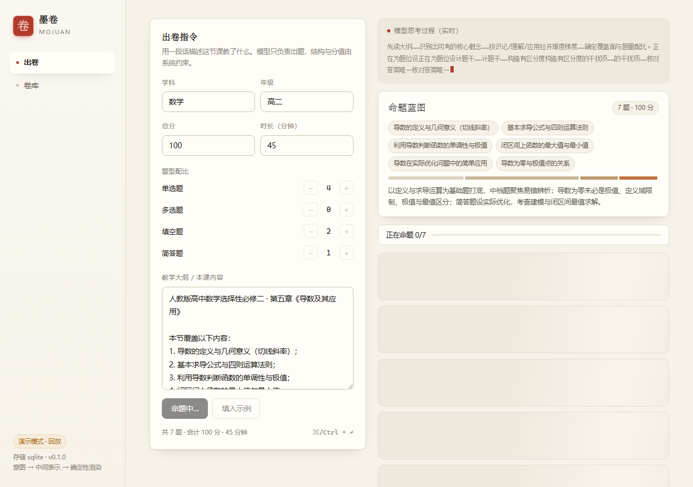
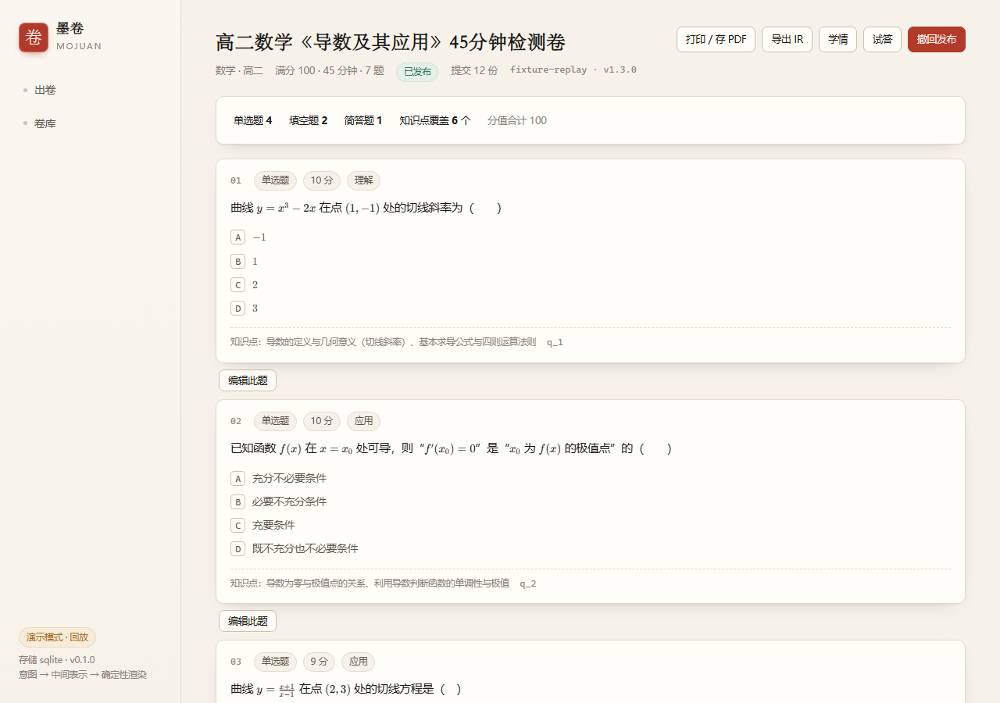

# 墨卷 MoJuan · 技术文档

**赛事**：全国高校 Vibe Coding 开发挑战赛
**选题方向**：#4 低代码与智能表单生成引擎
**一句话**：老师用一段话描述这节课教了什么，墨卷产出一份可编辑、可校验、可导出、可作答、可统计的试卷。

---

## 1. 摘要

大模型能写页面，但**它写出来的页面不可信**：这次能跑，下次字段对不上；今天分值加起来是 100，明天是 97。
所有"AI 生成应用"的翻车都不是因为它不会写代码，而是因为**没有任何东西在约束它写出来的东西是否自洽**。

墨卷的做法是把 AI 从"页面生成器"降级为"结构化内容生成器"：

```
自然语言意图  ──►  QuizIR（受 zod 与业务规则双重约束）  ──►  确定性渲染 / 判分 / 统计
```

模型只负责它擅长的部分（出题、写解析、给评分要点），
**结构、分值、题型、总分这些不变量由系统持有，模型无权改动**。
于是"AI 生成的"与"可被工程化验证的"第一次不再是矛盾。

最终交付：一个 6 环节闭环的 Web 应用 + 17 次细粒度提交 + 6 条真实 Prompt 链 + 9 项一键自检。

---

## 2. 问题定义：为什么"让 AI 直接写页面"必然翻车

我们最初也试过最省事的路径：给模型一段大纲，让它直接输出页面代码。
三个必然出现的问题在第 30 分钟内就暴露了：

| 问题 | 表现 | 本质 |
|---|---|---|
| **不可验证** | 生成出来的页面"看着对"，但分值合计 97、单选题两个答案 | 模型输出没有机器可检查的结构 |
| **不可复现** | 同一段大纲两次生成，题型配比、分值、难度完全不同 | 输出空间没有任何约束 |
| **不可维护** | 改一个字段要重读 600 行生成代码 | 生成物与业务逻辑纠缠在一起 |

结论：**要约束的不是 AI 的"手艺"，而是 AI 的"输出空间"**。
这直接推出了本文第 3 节的全部设计。

---

## 3. 意图控制策略（核心）

### 3.1 三段式提示词

一次生成被拆成三个阶段，每个阶段有独立的系统提示词与输出契约：

| 阶段 | 输出 | 是否流式 | 作用 |
|---|---|---|---|
| 蓝图 | JSON（标题 / 知识点覆盖 / 难度配比 / 命题思路） | 文本流式 | 先把"考什么、怎么分布"定下来，避免边写边乱 |
| 命题 | JSON（按题位分批，每批 2 题） | 逐批落地 | 把"写 7 道题"拆成"写 2 道题 × 4 次"，单次失败只影响一批 |
| 修复 | JSON（完整试卷） | 一次性 | 只处理校验器报出来的具体问题 |

拆阶段的收益是实测出来的：单阶段一次性出题时，简答题几乎必然因为输出预算被推理吃光而返回空内容；
拆成"简答题单独成批"后，同一份大纲的耗时从 74.7 秒降到 24.6 秒，且 0 轮修复。

### 3.2 契约先行：schema 即约束

`shared/ir.ts` 是前后端唯一真源。它承担三件事：

1. **类型**：`z.infer` 直接产出 TS 类型，前端不需要手写一遍接口；
2. **校验**：模型返回的 JSON 必须先过 `paperSchema`，否则永不入库；
3. **上限**：字段长度、数组长度、枚举值，全部显式声明。

一个真实的教训：最初把 `answers` 限制在 300 字符，结果真实生成的简答题参考解答有 600+ 字，
演示数据直接加载失败。修正不是简单调大数字，而是**分清两层**：

- **结构上限**放宽到人类真会写出来的规模（2000 字符 / 20 条细则）；
- **业务规则**（细则分值和等于题目分值、答案必须在选项内、蓝图题量与实际一致）交给 `validator.ts`，
  报出可读的中文错误，而不是让 zod 抛 `too_big`。

### 3.3 系统持有不变量

这是本项目最重要的一条设计决策：

> **分值不由模型决定。**

`allocateScores()` 按题型权重（单选 1、多选 1.6、填空 1.3、简答 4）用最大余数法分配分值，
保证：每项 ≥ 1 分、合计精确等于用户设定的总分。

为什么值得单独拿一节讲？因为如果让模型自己给分，它会稳定地产出"合计 97 分"
"单选 3 分、多选 12 分"这类结果，每一份卷子都要多走一轮修复——**这是纯粹的浪费**。
把不变量收归系统后，这一类校验失败从源头消失。

同理，题型与题位顺序也由系统固定，提示词里只告诉模型"第 3 题：填空题，12 分"。

### 3.4 校验失败 → 结构化回喂

`validator.ts` 输出的是机器可读的问题清单，而不是一句"格式不对"：

```json
{ "code": "RUBRIC_POINTS_MISMATCH",
  "path": "sections[0].questions[6].keywordRubric",
  "message": "细则分值合计 38，与题目分值 57 不一致" }
```

这份清单被压缩成 12 条以内的修复指令，随原试卷一起回喂模型，最多 2 轮。
仍不通过时的处理方式是关键：**把相关题目标记为 `needs-review` 后照常入库**，
而不是抛异常、也不是静默改分。

产品的态度是：AI 不可靠，但系统要可靠——一份"有 1 题待复核"的卷子，
比"什么都没有"有用得多。

### 3.5 给 AI 的约束条款（AGENTS.md）

项目根目录的 `AGENTS.md` 是每次让 AI 改代码前都要放进上下文的"工程宪法"，共 7 条铁律，摘录：

- AI 不得直接产出页面代码或业务逻辑；
- 密钥只在服务端，`web/` 下不得出现 `sk-`；
- 模型输出一律视为不可信数据，必须过 zod + 业务规则 + 净化；
- 不改依赖方向：`routes → domain → shared`；
- 不新增原生依赖；
- 任何 `while` 必须有显式上限，模型重试最多 2 轮；
- 每次改动必须让 `npm run verify` 保持绿色。

这份文件本身就是评审材料：它证明"约束 AI"不是口头上的，而是写进仓库、每次都要遵守的。

### 3.6 三个真实反例

| 反例 | 现象 | 修正 |
|---|---|---|
| 模型擅自改分值 | 合计 97/100，每题还要走一轮修复 | 分值改由 `allocateScores` 分配，模型无权 |
| 评分要点写成描述句 | 学生全对只得 63/97 | 提示词强制"keyword 必须从标准答案原样截取" |
| 输出预算被推理吃光 | 简答题返回空内容，整卷失败 | 简答题单独成批 + 输出预算分级 |

详见 `docs/prompts/` 下 6 份快照。

### 3.7 AI 助手：把"对话"接进"动作"

助手如果只会聊天，就是个挂件。墨卷的助手能真正改题，做法是把动作编码进流式文本的尾部：

```
模型输出：……第 3 题偏常规，可以让它多绕一步。<action>{"type":"revise_question","index":3,…}</action>
                  │                                                    │
           实时推给用户（可见文本）                            服务端摘掉、解析、执行
```

三个设计要点：

1. **流式过滤**：边收边发，一旦读到 `<action` 就停止外发，并扣住末尾可能是半个标签的字符。
   用户永远看不到协议，只看到"我把第 3 题改难了一点"。
2. **只做一个动作**：`revise_question`。宁可只有一个可靠动作，也不要十个半成品。
3. **不变量继续由系统持有**：改写时 `id / 题型 / 分值` 锁死，模型只能改题干、选项、答案、
   解析与难度；改完再跑整卷校验，只挑出这一题的问题回报。

为什么不用 function calling？当前接入的模型（含本地模型）对工具调用支持参差不齐，
而"尾部动作块"在任何纯文本模型上都能工作——**兼容性比协议优雅更重要**。

实测：说「把第 3 题改难一点，难度提到 4，并换掉干扰项」，难度 3 → 4、选项被替换、
状态转为 `edited`，页面随即自动刷新。

---

## 4. 架构设计

### 4.1 分层与依赖方向

```
┌─────────────────────────────────────────────┐
│  web/   React 页面（唯一接触 DOM 的层）        │
└──────────────────┬──────────────────────────┘
                   │ HTTP / SSE
┌──────────────────▼──────────────────────────┐
│  server/routes/   HTTP 边界、参数校验、SSE 编码 │
└──────────────────┬──────────────────────────┘
┌──────────────────▼──────────────────────────┐
│  server/domain/   生成 / 校验 / 评分 / 统计    │  ← 纯业务，不认识 Fastify
└──────────────────┬──────────────────────────┘
┌──────────────────▼──────────────────────────┐
│  shared/          zod 契约、类型、纯函数       │  ← 前后端唯一真源
└─────────────────────────────────────────────┘
         ▲
         │ 注入
┌────────┴────────────────────────────────────┐
│  server/infra/    模型客户端 / 仓储 / 回放     │
└─────────────────────────────────────────────┘
```

三条硬规则：

1. `domain` 不认识 HTTP 框架，因此可以被单测直接调用，也可以被 CLI / 脚本复用；
2. `shared` 不 import 任何实现，前端打包时不会把服务端代码拖进去；
3. 仓储与模型客户端都以接口形式注入，所以"真实模型"和"演示回放"是同一套上层代码。

### 4.2 数据流

```
POST /api/papers/generate
   │  SSE
   ├─ reasoning.delta   ×N   模型自述的推理片段（思考可视化）
   ├─ plan.done              命题蓝图
   ├─ item.start / item.done 逐题落地（并发 2 批，按题位回正顺序）
   ├─ validate.report        zod + 8 条业务规则的结论
   ├─ repair.attempt         第 N 轮修复
   ├─ paper.done             落库后的 paperId + 完整 IR
   └─ done / error           结束语义（前端永远不会永久转圈）
```

前端是一个严格的状态机：只认这 8 种事件，不猜、不补。
`done` 必然到达（`finally` 里发），所以"卡在转圈"在协议层面就不可能发生。

### 4.3 持久化：双驱动

| 驱动 | 触发 | 实现 |
|---|---|---|
| `sqlite` | 默认（Node ≥ 22.5） | Node 内置 `node:sqlite`，**零原生编译** |
| `json` | 老 Node 或显式指定 | 单文件 + 原子写（tmp → rename） |

两者实现同一套 `PaperRepo` 接口，同一份自检脚本、同一套单元测试语义。
这是对"评委机器上装不上依赖"最直接的对冲——**从根上没有 node-gyp**。

试卷被当作聚合根整体读写：一份卷子只有一份 IR 是真源，
避免"题目表"与"IR"两份数据长期漂移。

### 4.4 演示模式

没有 API Key 时自动进入演示模式：回放 `fixtures/demo-paper.json`。
这份数据不是手写的，是 `scripts/record-demo.ts` 真实调用模型生成后落盘的。

回放通道做了两件事，使它经得起"评委随手改参数"：

1. **按题型分队列取题**，而不是按下标硬切（否则改题型配比就会得到填空题带选项的怪卷）；
2. **按目标分值等比缩放评分细则**，余数补给分值最高的条目（否则细则之和与题目分值不一致）。

---

## 5. 工程质量

### 5.1 测试

32 个单元测试，全部落在纯函数层，不依赖网络与数据库：

| 文件 | 覆盖 |
|---|---|
| `tests/ir.test.ts` | schema 正反例、统计派生 |
| `tests/grading.test.ts` | 归一化边界（全角 / 负号变体 / 空答案 / 数值容差）、四类题型评分、重复评分一致性 |
| `tests/validator.test.ts` | 9 条业务规则各自的触发条件 |
| `tests/domain.test.ts` | 分值分配（合计 / 下限 / 权重）、学情聚合（平均分 / 及格率 / 知识点 / 失分榜） |

### 5.2 一键自检

`npm run verify` 跑 9 项检查，**强制演示模式 + 临时数据目录，不读 Key、不联网、不污染数据**：

```
✓ 环境与仓储初始化          ✓ 人工改题可持久化
✓ 回放生成且 IR 通过 zod    ✓ 提交作答 → 确定性评分
✓ 业务规则校验              ✓ 学情统计与作答一致
✓ 公式可被 KaTeX 渲染       ✓ IR 导出可下载且结构完整
                            ✓ 无 Key 回放具备确定性
9/9 passed
```

### 5.3 安全

| 面 | 措施 |
|---|---|
| 密钥 | 只在服务端 `.env`；`.gitignore` 首行；日志脱敏；`git log -S"sk-"` 为空 |
| 注入 | 模型输出先过 zod，再过业务规则，最后经 DOMPurify 净化；KaTeX `trust:false` |
| XSS | 公式先渲染成可信 HTML → 正文净化 → 最后回填占位符（顺序反了就是漏洞） |
| 滥用 | 生成接口 6 次/分钟/IP，请求体上限 64KB |
| 越权 | 无账号体系，但所有写接口都校验资源存在性与发布状态 |

### 5.4 性能

| 指标 | 实测 |
|---|---|
| 首屏（生产构建，本地） | < 1s |
| 7 题生成（真实模型） | 24.6s（串行单批方案为 74.7s） |
| 判分 + 落库 | < 50ms |
| 学情聚合（12 份提交） | < 10ms |
| 构建产物 | 677KB JS（gzip 205KB），主要来自 KaTeX 字体内联 |

---

## 6. 可复现性论证

### 6.1 三条命令

```bash
npm install && npm run build && npm start
```

无原生依赖、无 Docker、无数据库服务、无外部 API（演示模式）。
Node ≥ 20.11 即可；Node < 22.5 时自动降级 JSON 驱动。

### 6.2 验证矩阵

| 场景 | 期望 | 已验证 |
|---|---|---|
| 无 Key、断网 | 演示模式全闭环 | ✓ |
| 有 Key | 真实流式生成 | ✓ |
| Node 24 + sqlite | 正常 | ✓ |
| 强制 `DB_DRIVER=json` | 正常，自检同样 9/9 | ✓ |
| 生产单进程托管 | 页面与 assets 均 200 | ✓ |
| 改题型配比（演示模式） | 自动收窄并保持自洽 | ✓ |

### 6.3 失败模式与降级

| 失败 | 系统行为 |
|---|---|
| 模型超时 / 空响应 | 单批重试一次（更大输出预算）；仍失败则报错并保留已生成题目 |
| 校验不过 | 回喂修复 2 轮；仍不过标记 `needs-review` 后正常入库 |
| `node:sqlite` 不可用 | 自动切 JSON 驱动，日志明示 |
| 客户端断开 | 监听响应端 close，中止下游调用（止损） |
| 端口占用 | `PORT=4001 npm start` |

### 6.4 跨机验证

交付前在 `%TEMP%` 下全新目录执行完整序列（install → build → verify → start → seed），
确认与开发机行为一致；截图均来自该构建，而非设计稿。

---

## 7. 演进链路

17 次提交，按依赖顺序推进：契约 → 基础设施 → 领域 → 接口 → 前端 → 工程化 → 文档。
每次提交对应一次协作决策，提交体带 `Prompt-ID` 尾注，可回查 `docs/prompts/`。

三个真实故障构成了"引导 AI 修复"的证据链（详见 `docs/EVIDENCE.md`）：

1. **SSE 自杀**：把 `request.close` 当作客户端断开，导致每个生成请求开头就被自己取消；
2. **空响应**：推理模型把输出预算吃光，修正不是"加大重试"而是"缩小单次任务"；
3. **生产白屏**：`@fastify/static` 关掉 wildcard，assets 全部 404。

第三条尤其说明问题：它在开发模式下永远暴露不出来，
**只有"用生产构建截一张图"这个动作能发现它**。

---

## 8. 局限与下一步

诚实列出边界：

1. **简答题评分是粗糙的**。关键词细则无法判断推理过程，因此所有简答题强制进入教师复核队列，
   系统不假装能替代人工。
2. **单实例**。限流与存储都在进程内，不支持多租户与水平扩展。
3. **无账号体系**。赛题场景是单教师演示，权限模型被刻意省略。
4. **蓝图与命题是串行两段**。理论上可以让模型一次产出并自校验，但实测失败率更高。

下一步（如果继续）：

- 题库沉淀：把 `needs-review` 的题目人工修订后回流成"已验证题库"，下次生成优先复用；
- 变式生成：基于同一知识点的 IR 做参数扰动，一道题生成三个变式；
- 学情反哺命题：把知识点正确率喂回蓝图阶段，自动提高薄弱点的题量权重。

---

## 附录 A · 关键文件索引

| 文件 | 职责 |
|---|---|
| `shared/ir.ts` | QuizIR 契约（模型输出空间的定义） |
| `shared/events.ts` | SSE 事件协议 |
| `server/domain/generator.ts` | 三段式生成与修复回路 |
| `server/domain/validator.ts` | 8 条业务规则 |
| `server/domain/scoring.ts` | 分值分配（系统持有不变量） |
| `server/domain/grader.ts` | 确定性评分 |
| `server/infra/demo.ts` | 演示回放（题型队列 + 细则缩放） |
| `server/routes/papers.ts` | SSE 边界与断连处理 |
| `scripts/verify.ts` | 9 项一键自检 |

## 附录 B · 第三方依赖

`fastify`、`@fastify/static`、`zod`、`react`、`react-dom`、`vite`、`marked`、`dompurify`、`katex`、`typescript`、`vitest`。
均为 MIT / Apache-2.0 许可，无原生编译依赖。

---

## 附录 C · 界面速览

**出卷：意图下达与流式生成过程**



**试卷：题目卡片、公式渲染、人工校订入口**



**学情：知识点正确率与失分题榜**


---

## 附录 D · 命令速查

| 命令 | 作用 | 是否必需 |
|---|---|---|
| `npm install` | 安装依赖 | 首次必跑 |
| `npm run build` | 构建前端产物 | 生产模式必跑 |
| `npm start` | 单进程启动（API + 前端） | 二选一 |
| `npm run dev` | 开发模式（4000 API + 5173 前端热更） | 二选一 |
| `npm run verify` | 9 项一键自检 | **评委优先跑这个** |
| `npm run seed` | 灌入演示试卷与 12 份作答 | 想看学情页时 |
| `npm test` | 32 个单元测试 | 可选 |
| `npm run typecheck` | 全量类型检查 | 可选 |
| `npm run shot -- <url> <out.png>` | 截图（CDP） | 可选 |
| `node scripts/md-to-pdf.mjs <in.md> <out.pdf>` | 本文档的生成方式 | 可选 |
